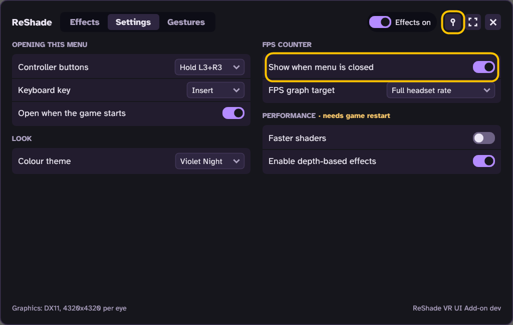
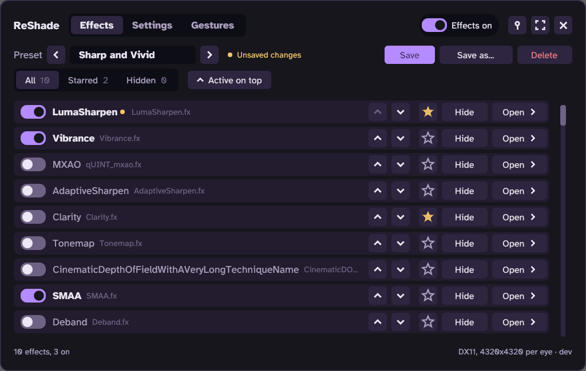

# ReShade VR UI Add-on

Adds a menu inside your VR headset for ReShade effects. Turn effects on and off, change their settings and **switch presets with head gestures**, without taking the headset off.

## Download

**[⬇ Download the newest version](https://github.com/wyerdev/ReShade-VR-UI-Addon/releases/latest)**

## Which One Do I Need?

| Your game | Install steps |
| --- | --- |
| OpenXR VR game or UEVR | [OpenXR and UEVR](tools/reshade-openxr-ui/INSTALL.md) |
| SteamVR game | [SteamVR](tools/reshade-openxr-ui/INSTALL-SteamVR.md) |
| Vulkan VR game | [Vulkan](tools/reshade-openxr-ui/INSTALL-Vulkan.md) |

Not sure? See [Which type is my game?](#which-type-is-my-game)

## Features

- **Headset menu (OpenXR games, including UEVR):** turn effects on and off, change their settings, and save or switch presets.
- **Head gesture to switch presets (OpenXR games):** raise a hand to the side of your head and press a button to switch to the next preset, for example from a preset for dark scenes to one for bright scenes.
- **Pin the menu (OpenXR games):** keep it to one side, out of your way.
- **Pin the FPS counter (OpenXR games):** always see your FPS, even with the menu closed.

**SteamVR games** don't get this menu. You use ReShade's own menu from the ReShade icon in the SteamVR dashboard. See the [SteamVR steps](tools/reshade-openxr-ui/INSTALL-SteamVR.md).

## Which Type Is My Game?

Playing it with UEVR? Then it's **OpenXR**. Otherwise, use one of these two options:

**Option 1: Check the game folder (about a minute)**

1. In Steam, right-click the game, then **Manage** > **Browse local files**.
2. In the search box at the top right of that window, search for `openxr_loader`, then for `openvr_api`.
3. Only `openxr_loader` found: it's **OpenXR**. Only `openvr_api` found: it's **SteamVR**. Both or neither: use Option 2.

To check for Vulkan, look the game up on [PCGamingWiki](https://www.pcgamingwiki.com/) under **API**. Not every game has a page there.

**Option 2: Just try OpenXR**

1. Follow the [OpenXR steps](tools/reshade-openxr-ui/INSTALL.md).
2. If the menu doesn't show up in the headset, it's probably a SteamVR game. Uninstall ReShade for that game in ReShade Setup, then follow the [SteamVR steps](tools/reshade-openxr-ui/INSTALL-SteamVR.md).

You can leave the OpenXR add-on installed. It does nothing in other games.

## What The Add-on Changes On Your PC

OpenXR games find add-ons like this one through two lists in the Windows registry: one for 64-bit games, one for 32-bit games. The OpenXR add-on:

- copies four files to `C:\Program Files\ReShade VR UI Add-on`,
- adds its entry to both lists, set to `0` (on), so your OpenXR games load it. If you had set an entry to `1` (off), it stays off.

While you play, it saves its own settings in `%LOCALAPPDATA%\ReShade VR UI Add-on`. Uninstalling deletes both entries and the four files, and keeps your settings. Nothing else changes: not your game folders, not ReShade. Full details, and how to switch entries on and off: [What the OpenXR add-on changes on your PC](tools/reshade-openxr-ui/OPENXR-LAYERS.md).

## Something Not Working?

The end of each install guide has **Help** (unzipping, finding the game folder) and **Troubleshooting**.

**A 32-bit VR game or VR mod shows only on the monitor** (for example BioShock Remastered VR): ReShade's entry in the 32-bit list can stop it when ReShade isn't installed for that game. Fix it one of these ways:

- Install ReShade for the game, as in the [OpenXR steps](tools/reshade-openxr-ui/INSTALL.md).
- Install the OpenXR add-on, or keep it installed (not yet tested).
- To play without ReShade: set ReShade's 32-bit entry to `1` (off): [steps](tools/reshade-openxr-ui/OPENXR-LAYERS.md#vr-game-shows-only-on-the-monitor).

## For Developers

Building, testing and releases: [DEVELOPERS.md](DEVELOPERS.md).

## Credits

- [ReShade](https://reshade.me/) by crosire
- [UEVR](https://uevr.io/) by praydog
- [Dear ImGui](https://github.com/ocornut/imgui) by Omar Cornut (the headset menu)
- OpenXR by Khronos, OpenVR by Valve

## License

MIT License, see [LICENSE](LICENSE). ReShade, Dear ImGui, the OpenXR SDK and OpenVR keep their own licenses, see [THIRD-PARTY-NOTICES.txt](THIRD-PARTY-NOTICES.txt).
