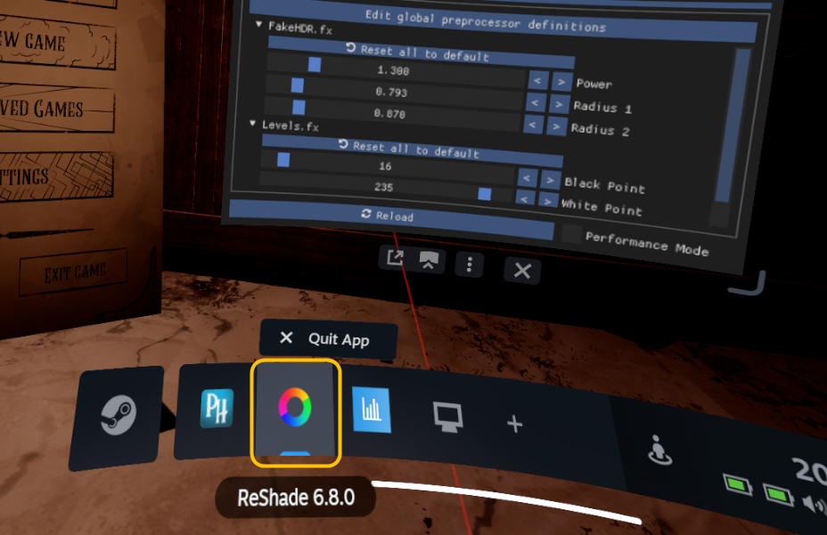

# ReShade In Vulkan VR Games

**ReShade already works in Vulkan games on its own. You don't need the add-on.**

## Install

1. For each game, install ReShade. **Tick** the **OpenXR** layer only for OpenXR games.
2. SteamVR games, optional, smaller menu text: copy [`ReShadeVR.ini`](https://github.com/wyerdev/ReShade-VR-UI-Addon/releases/latest/download/ReShadeVR.ini) next to the game's `.exe`. Already there? See [Troubleshooting](#troubleshooting).
3. SteamVR games: in the SteamVR dashboard, click the ReShade icon with your controller.



<details><summary><b>Step by step</b></summary>

1. Download ReShade from [reshade.me](https://reshade.me/).
2. Run ReShade Setup and pick the game's `.exe`. Choose **Vulkan**. **Tick** the **OpenXR** layer only for OpenXR games.
3. SteamVR games, optional, smaller menu text: copy the downloaded `ReShadeVR.ini` next to the game's `.exe`. Already there? See [Troubleshooting](#troubleshooting).
4. SteamVR games: start the game. In the SteamVR dashboard, click the ReShade icon with your controller. ReShade adds this icon by itself.

</details>

## Tested

- Half-Life 2 VR (32-bit, Vulkan, SteamVR): effects and ReShade's menu work in the headset.

## Help

- **Find the game folder:** in Steam, right-click the game, choose **Manage**, then **Browse local files**. Put files into the folder that has the `.exe`.
- **See file endings like `.exe`:** in File Explorer, open **View** and tick **File name extensions** (Windows 11: **View**, **Show**, **File name extensions**).

## Troubleshooting

- No ReShade icon in SteamVR: check that ReShade is installed for the game (a `ReShade.log` file appears next to the game's `.exe` after you start it).
- You installed ReShade for this SteamVR game before with the **OpenXR** layer **ticked**: open ReShade Setup, pick the game, choose **Uninstall**, then install again with the **OpenXR** layer **unticked**.
- Menu looks zoomed in (SteamVR games): close the game. Put [`ReShadeVR.ini`](https://github.com/wyerdev/ReShade-VR-UI-Addon/releases/latest/download/ReShadeVR.ini) next to the game's `.exe`. Already there? Open it with Notepad and set these lines under `[STYLE]`:

  ```ini
  FontScale=1.000000
  FontSize=12.000000
  ```

- Anything else: close the game and delete `ReShade.log` next to the game's `.exe`. Start the game until the problem shows, close it, then give the new `ReShade.log` to an AI assistant (for example ChatGPT or Copilot) and ask what is wrong.
