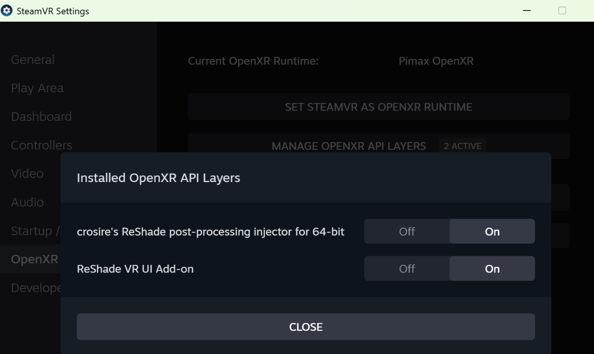

# What The OpenXR Add-on Changes On Your PC

OpenXR VR games load extra parts called layers. The add-on is one, ReShade is another. Windows keeps the list of layers in the registry. Each entry has a value: `0` means on, `1` means off.

The registry has two lists:

- 64-bit games: `HKEY_LOCAL_MACHINE\SOFTWARE\Khronos\OpenXR\1\ApiLayers\Implicit`
- 32-bit games: `HKEY_LOCAL_MACHINE\SOFTWARE\WOW6432Node\Khronos\OpenXR\1\ApiLayers\Implicit`

## Install (`Install-OpenXR.cmd`)

- Copies two files into `C:\Program Files\ReShade VR UI Add-on`: `ReShade-OpenXR-UI.addon64` and `openxr-layers\ReShade-OpenXR-UI-Layer.json`. Older copies are replaced.
- Adds the entry `C:\Program Files\ReShade VR UI Add-on\openxr-layers\ReShade-OpenXR-UI-Layer.json` to the 64-bit list, set to `0` (on). If that entry was already `1` (off), it stays `1` (off).
- Changes nothing else: not the 32-bit list, not ReShade's entries, not your game folders.

## While You Play

- Saves the add-on's own settings in `%LOCALAPPDATA%\ReShade VR UI Add-on`.
- Effect changes and presets are saved by ReShade, in ReShade's own preset files.

## Uninstall (`Uninstall-OpenXR.cmd`)

- Deletes the entry `C:\Program Files\ReShade VR UI Add-on\openxr-layers\ReShade-OpenXR-UI-Layer.json` from the 64-bit list.
- Deletes the two installed files, then the folder `C:\Program Files\ReShade VR UI Add-on` if nothing else is in it.
- Keeps your settings in `%LOCALAPPDATA%\ReShade VR UI Add-on`. Delete that folder if you don't need them.
- Changes nothing else: not the 32-bit list, not ReShade's entries, not your game folders.

## What ReShade Setup Adds

When you **tick** the **OpenXR** layer in ReShade Setup, for any game, it adds both entries, set to `0` (on):

- `C:\ProgramData\ReShade\ReShade64_XR.json` to the 64-bit list.
- `C:\ProgramData\ReShade\ReShade32_XR.json` to the 32-bit list.

If you had set either entry to `1` (off), this sets it back to `0` (on).

Every OpenXR game then tries to load ReShade. ReShade runs only in games with a `ReShade.ini` next to the game's `.exe` (ReShade Setup creates it for each game you pick). In all other games it refuses to load.

## Switch 64-bit Entries In SteamVR

SteamVR shows the entries in the 64-bit list. Open **SteamVR Settings**, then **OpenXR**, then **Manage OpenXR API Layers**. **On** is `0` (on), **Off** is `1` (off).

SteamVR does not show the 32-bit list. Change that list in `regedit`, as below.

## VR Game Shows Only On The Monitor

ReShade's entry in the 32-bit list can stop 32-bit VR games without a `ReShade.ini` from starting in VR (for example the BioShock Remastered VR mod). Set it to `1` (off):

1. Close the game. Open `regedit` as administrator.
2. Go to the 32-bit list: `HKEY_LOCAL_MACHINE\SOFTWARE\WOW6432Node\Khronos\OpenXR\1\ApiLayers\Implicit`.
3. Double-click `C:\ProgramData\ReShade\ReShade32_XR.json`. Change **Value data** from `0` (on) to `1` (off) and click **OK**.

This switches ReShade off for all 32-bit OpenXR games. To switch it back on, change the value to `0` (on). The 64-bit list is not changed, so 64-bit games and the add-on work as before.

Ticking **OpenXR** in ReShade Setup again sets this entry back to `0` (on). Repeat the steps afterwards.
